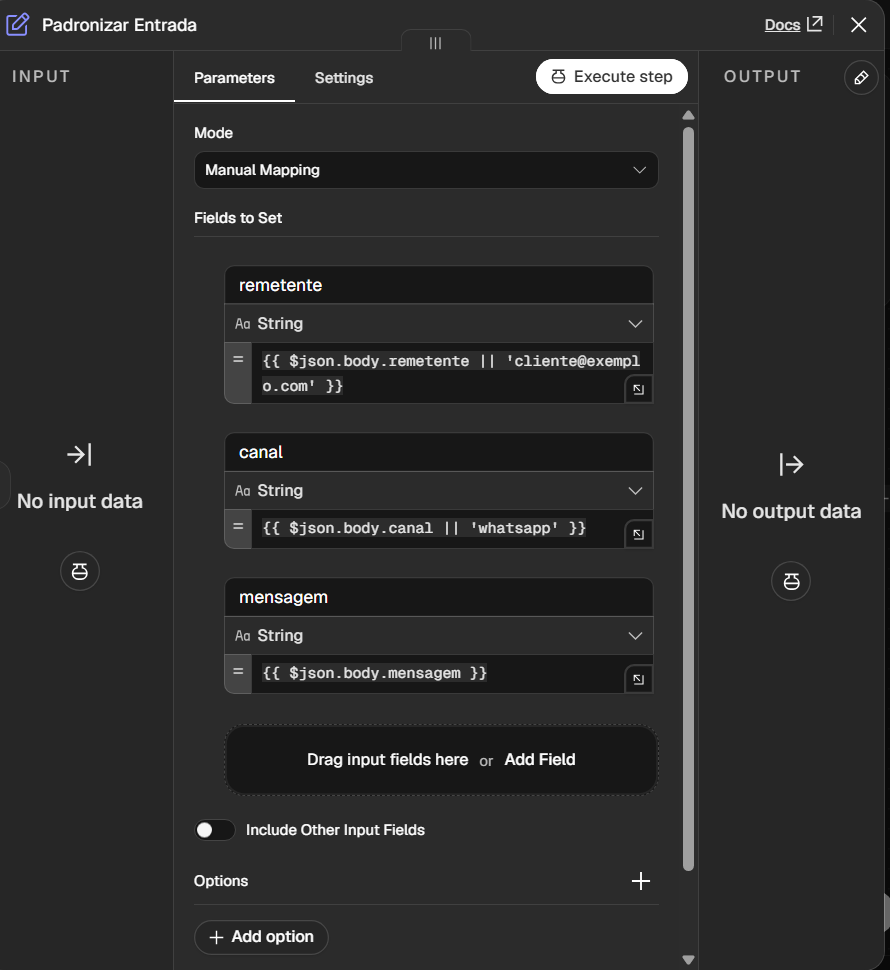
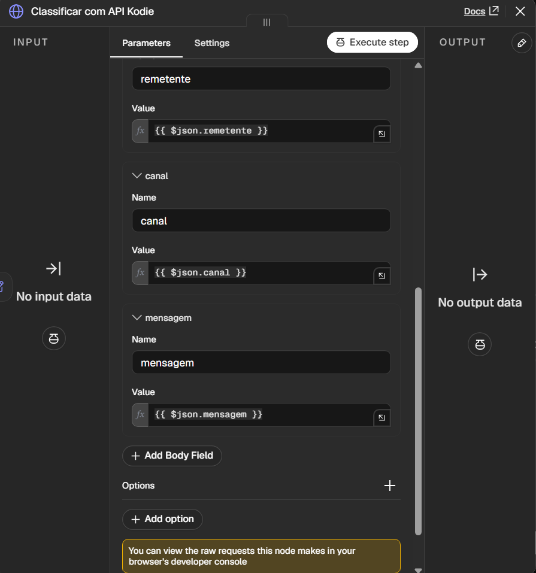
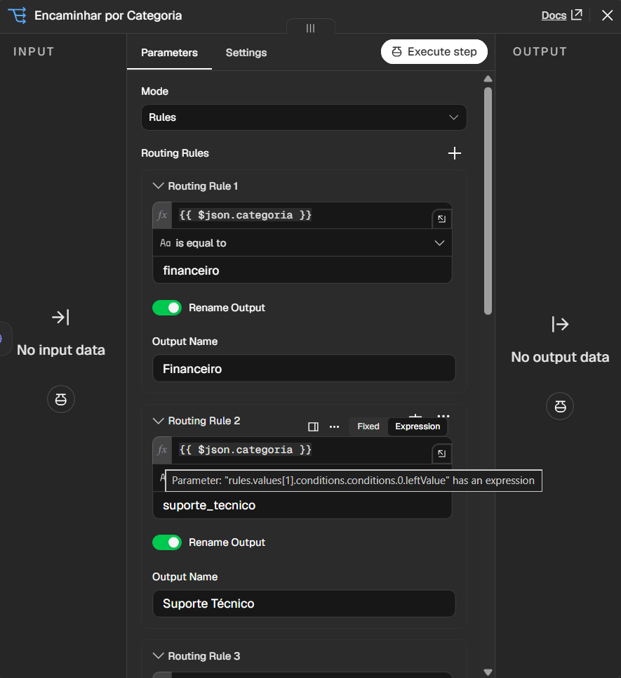
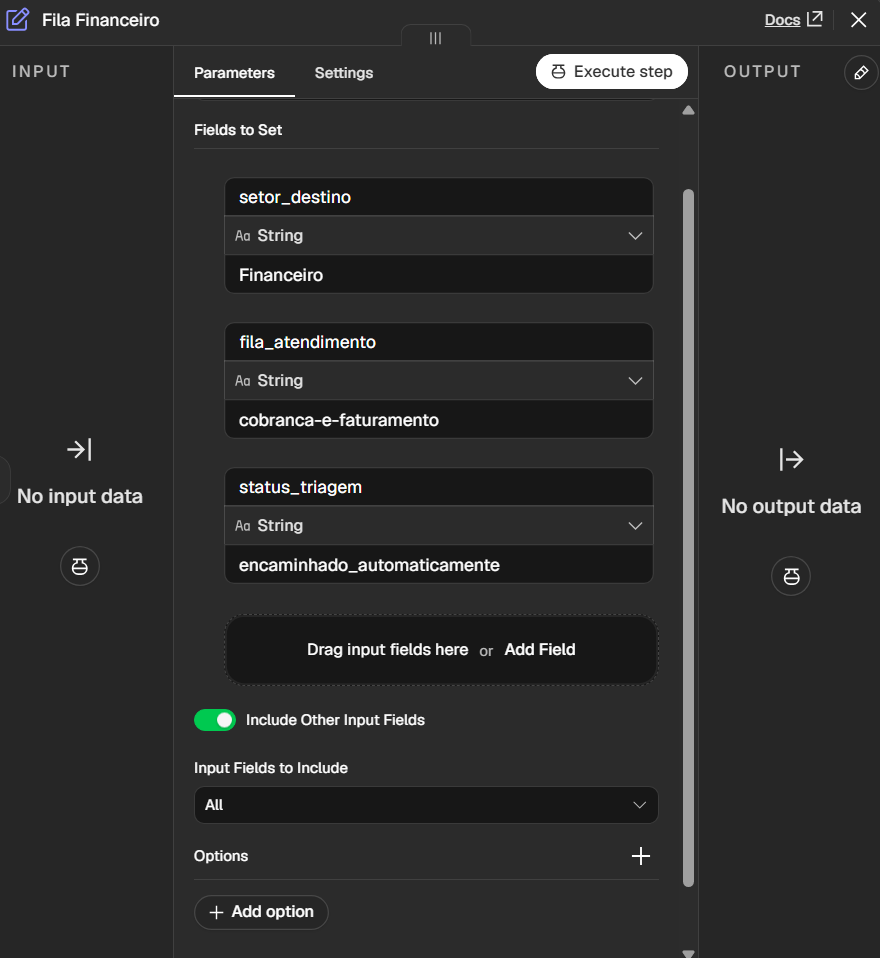
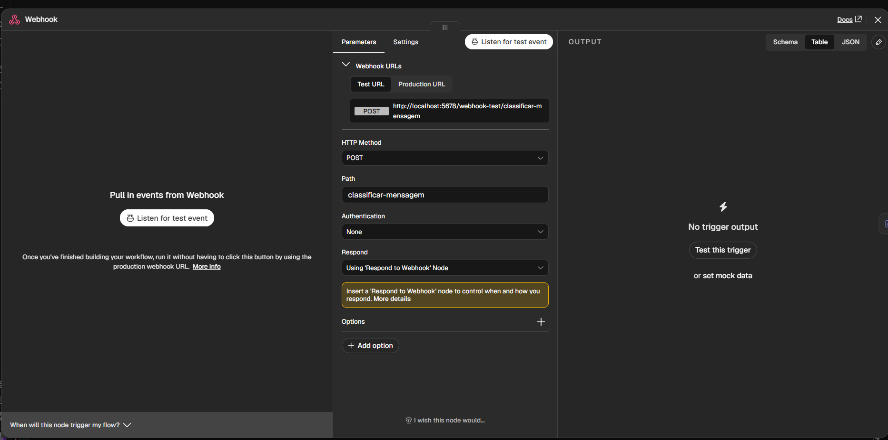
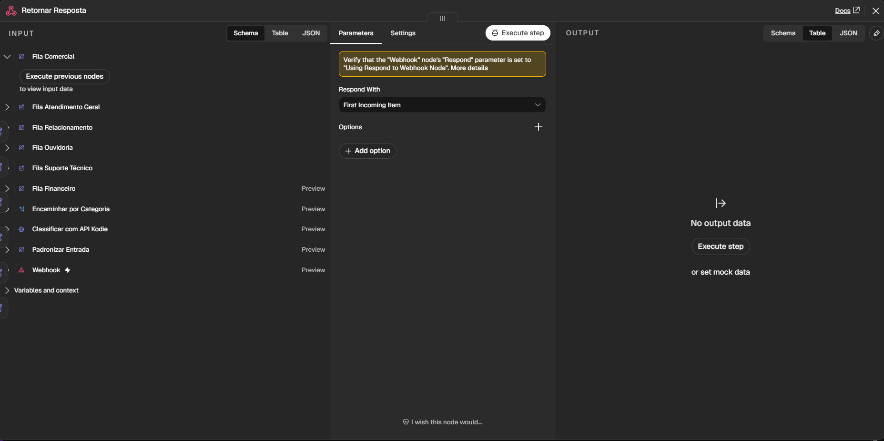

# Anubis Helpdesk — Classificador de Mensagens com IA e Automação n8n

Sistema full-stack de classificação inteligente de mensagens em português, gestão de chamados e roteamento automático de atendimentos, desenvolvido para o Desafio Técnico de IA e Automação do programa IA para Todos, da Kodie Academy.

O projeto integra uma API REST em FastAPI com Google Gemini, persistência em SQLite, autenticação JWT, interface web em React e TypeScript, automação no n8n e execução do portal e da API com Docker Compose.

## 1. Apresentação da Ideia

O **Anubis Helpdesk** foi alinhado como uma solução de atendimento ao cliente capaz de transformar mensagens não estruturadas em informações organizadas e úteis para a operação de uma central de atendimento.

A proposta surgiu do cenário de classificação de mensagens apresentado no desafio técnico. A partir desse cenário, o projeto foi ampliado para incluir um portal de chamados com autenticação, protocolos de atendimento, histórico e acompanhamento de status, demonstrando uma aplicação prática da inteligência artificial integrada à automação de processos.

## 2. Problema Escolhido

Empresas recebem solicitações de clientes por diferentes canais, como WhatsApp, e-mail, chat e telefone. Quando a triagem é realizada manualmente, o volume de mensagens pode dificultar a identificação de assuntos urgentes e o encaminhamento para as equipes responsáveis.

Entre os principais problemas desse processo estão:

- Tempo gasto na leitura e classificação manual de mensagens.
- Encaminhamento de solicitações para setores inadequados.
- Dificuldade para identificar prioridades e insatisfações dos clientes.
- Falta de padronização das informações de atendimento.
- Dificuldade de acompanhar o histórico e a situação de cada solicitação.

O problema escolhido é a **automatização da triagem inicial de mensagens de atendimento**, utilizando IA para interpretar o conteúdo e regras de negócio para identificar o setor e a fila correspondentes.

## 3. Solução Proposta

A solução combina dois fluxos complementares que utilizam a mesma lógica de classificação com Google Gemini:

- **Portal Web de Chamados:** permite cadastrar usuários, realizar login, abrir chamados, consultar protocolos, acompanhar o histórico e atualizar o status dos atendimentos. A API classifica cada nova mensagem, define seu destino e registra o chamado no banco de dados.
- **Automação n8n:** recebe mensagens por um Webhook HTTP, normaliza os dados de entrada, consulta a API de classificação e adiciona as informações de roteamento, devolvendo uma resposta JSON consolidada.

O campo `canal` representa a origem informada da mensagem. Nesta versão, WhatsApp, e-mail, chat e telefone são exemplos de canais que podem ser representados nos dados enviados; não há conectores diretos com esses serviços.

### 3.1. Funcionalidades

- **Classificação inteligente:** identificação de categoria, prioridade, sentimento, resumo, ação sugerida e confiança informada pela IA.
- **Roteamento automático:** identificação do setor e da fila de atendimento conforme a categoria classificada.
- **Autenticação e autorização:** cadastro, login, armazenamento de senhas com hash bcrypt e proteção das rotas de chamados por token JWT.
- **Gestão de chamados:** geração de protocolo único no formato `CHM-YYYYMMDD-XXXX`, persistência, consulta por protocolo, filtros e atualização de status.
- **Interface web responsiva:** painel de métricas, formulário de abertura de chamados, apresentação da análise da IA e histórico de atendimentos.
- **Automação HTTP:** processamento de mensagens pelo n8n com resposta estruturada em JSON e novas tentativas em caso de falhas no node HTTP Request.
- **Containerização:** execução do back-end e do front-end com Docker Compose e volume persistente para o banco SQLite.

### 3.2. Benefícios esperados

A solução busca reduzir o trabalho manual de triagem, padronizar as informações recebidas, facilitar a identificação de solicitações urgentes e melhorar a organização dos atendimentos. A ação sugerida pela IA serve de apoio à equipe responsável, sem executar automaticamente ações externas, como pagamentos, envio de e-mails ou alterações em sistemas de terceiros.

## 4. Tecnologias Utilizadas

| Camada | Tecnologias | Finalidade |
| :--- | :--- | :--- |
| Back-end | Python 3.12, FastAPI, Uvicorn | Desenvolvimento e execução da API REST |
| Validação | Pydantic v2, Pydantic Settings | Contratos de dados e configurações |
| Inteligência artificial | Google Gemini API (`google-genai`) | Interpretação e classificação das mensagens |
| Persistência | SQLite, SQLAlchemy | Armazenamento de usuários e chamados |
| Segurança | PyJWT, bcrypt | Autenticação por token e hash de senhas |
| Front-end | React, TypeScript, Vite | Interface web e integração com a API |
| Servidor web | Nginx | Distribuição do front-end containerizado |
| Automação | n8n | Orquestração, roteamento e resposta HTTP |
| Testes | Pytest, HTTPX, FastAPI TestClient | Validação automatizada da API |
| Infraestrutura | Docker, Docker Compose | Execução integrada do portal e do back-end |
| Versionamento | Git, GitHub | Controle de versões e documentação |

## 5. Funcionamento do Sistema

### 5.1. Arquitetura

O portal web e o workflow n8n utilizam a mesma API FastAPI, porém executam fluxos distintos. O portal registra chamados no SQLite; o workflow n8n realiza a classificação e o roteamento de mensagens avulsas, sem cadastrar chamados no banco de dados.

```text
Portal Web (React / Nginx)
    |
    v
API FastAPI -----> Google Gemini
    |
    v
SQLite (usuários e chamados)

Webhook n8n (POST)
    |
    v
Padronizar Entrada (Edit Fields)
    |
    v
Classificar com API Kodie (HTTP Request -> FastAPI -> Gemini)
    |
    v
Encaminhar por Categoria (Switch)
    |
    +-- Financeiro ------> Fila Financeiro -----------+
    +-- Suporte Técnico -> Fila Suporte Técnico ------+
    +-- Comercial -------> Fila Comercial ------------+
    +-- Reclamação ------> Fila Ouvidoria -------------+
    +-- Elogio ----------> Fila Relacionamento --------+
    +-- Fallback --------> Fila Atendimento Geral -----+
                                                      |
                                                      v
                                         Retornar Resposta (JSON)
```


*Figura 1 — Visão completa do workflow de classificação e roteamento no n8n.*

### 5.2. Fluxo do Portal Web

1. O usuário realiza o cadastro e o login.
2. A API valida as credenciais e retorna um token JWT.
3. O usuário informa o canal de origem e a mensagem para abertura do chamado.
4. A API envia a mensagem para o serviço de classificação com Google Gemini.
5. A classificação retornada é validada e utilizada para definir o setor e a fila de atendimento.
6. O chamado é registrado no SQLite com protocolo único e status inicial `aberto`.
7. O usuário pode consultar os seus chamados, filtrar resultados, buscar um protocolo e atualizar o status.

As rotas protegidas verificam a autenticação e a permissão de acesso ao chamado. Usuários comuns acessam os próprios registros; usuários com perfil administrativo podem acessar os registros de outros usuários.

### 5.3. Inteligência Artificial e Prompt

O prompt do sistema está em [`app/prompts/classifier_prompt.py`](app/prompts/classifier_prompt.py). Ele estabelece regras para a interpretação das mensagens em português do Brasil e define os seis campos esperados na classificação.

| Campo | Descrição | Valores ou formato |
| :--- | :--- | :--- |
| `categoria` | Assunto principal da mensagem | `suporte_tecnico`, `financeiro`, `comercial`, `reclamacao`, `elogio`, `outros` |
| `prioridade` | Nível de urgência | `alta`, `media`, `baixa` |
| `sentimento` | Tom predominante da mensagem | `positivo`, `neutro`, `negativo` |
| `resumo` | Síntese objetiva da solicitação | Texto |
| `acao_sugerida` | Próximo passo recomendado à equipe | Texto |
| `confianca` | Confiança informada pelo modelo | Número entre 0 e 1 |

O serviço [`app/services/gemini_service.py`](app/services/gemini_service.py) utiliza a API do Gemini com resposta JSON estruturada e temperatura `0.1`. Os contratos definidos em [`app/schemas/classification.py`](app/schemas/classification.py) validam os dados de entrada e o formato da classificação.

A confiança retornada é uma estimativa produzida pelo modelo, não uma medida de acurácia validada estatisticamente. O resultado pode ser revisado pela equipe responsável quando necessário.

### 5.4. Fluxo de Automação no n8n

O workflow exportado está disponível em [`n8n/workflow_classificador_mensagens.json`](n8n/workflow_classificador_mensagens.json).

| Etapa | Node | Função |
| :--- | :--- | :--- |
| 1 | Webhook | Recebe uma requisição HTTP POST com a mensagem |
| 2 | Padronizar Entrada | Organiza os campos `remetente`, `canal` e `mensagem` |
| 3 | Classificar com API Kodie | Envia os dados para o endpoint `/api/v1/classify` |
| 4 | Encaminhar por Categoria | Seleciona a saída correspondente à categoria ou o fallback |
| 5 | Nodes de fila (Edit Fields) | Adicionam os campos operacionais de roteamento |
| 6 | Retornar Resposta | Devolve o JSON consolidado ao solicitante |

O node HTTP Request utiliza `Retry On Fail`, com intervalo de 3 segundos entre tentativas, para lidar com falhas temporárias de comunicação.

Os nodes de fila utilizam `Include Other Input Fields`, preservando os seis campos retornados pela IA e acrescentando `setor_destino`, `fila_atendimento` e `status_triagem`.

### 5.5. Regras de Roteamento

A API de chamados e o workflow n8n utilizam os mesmos identificadores de setor e fila:

| Categoria | Node de destino no n8n | Setor de destino | Fila de atendimento |
| :--- | :--- | :--- | :--- |
| `financeiro` | Fila Financeiro | Financeiro | `cobranca-e-faturamento` |
| `suporte_tecnico` | Fila Suporte Técnico | Suporte Técnico | `chamados-tecnicos` |
| `comercial` | Fila Comercial | Comercial | `vendas-e-orcamentos` |
| `reclamacao` | Fila Ouvidoria | Ouvidoria / Reclamações | `atendimento-prioritario` |
| `elogio` | Fila Relacionamento | Relacionamento (CS) | `feedbacks-positivos` |
| `outros` (fallback) | Fila Atendimento Geral | Atendimento Geral | `triagem-humana` |

No n8n, o campo `status_triagem` recebe o valor `encaminhado_automaticamente`, inclusive quando o destino é a fila de triagem humana. Esse campo representa o roteamento lógico realizado pelo workflow, não a resolução da solicitação ou a entrega a uma fila externa.

No portal, os chamados são registrados inicialmente com `status = aberto` e podem assumir os seguintes estados: `aberto`, `em_andamento`, `resolvido` e `fechado`.

### 5.6. Principais Endpoints da API

| Método | Rota | Descrição | Autenticação |
| :--- | :--- | :--- | :--- |
| GET | `/health` | Verifica a disponibilidade da API | Pública |
| POST | `/api/v1/classify` | Classifica uma mensagem avulsa com Gemini | Pública |
| POST | `/api/v1/auth/register` | Cadastra um usuário | Pública |
| POST | `/api/v1/auth/login` | Autentica credenciais e retorna o token JWT | Pública |
| GET | `/api/v1/auth/me` | Retorna os dados do usuário autenticado | Bearer JWT |
| POST | `/api/v1/tickets` | Cria um chamado, classifica e gera protocolo | Bearer JWT |
| GET | `/api/v1/tickets` | Lista chamados com filtros opcionais de status e categoria | Bearer JWT |
| GET | `/api/v1/tickets/{protocolo}` | Consulta um chamado pelo protocolo | Bearer JWT |
| PATCH | `/api/v1/tickets/{protocolo}/status` | Atualiza o status do chamado | Bearer JWT |

### 5.7. Estrutura do Projeto

```text
kodie_classificador_mensagens/
├── app/
│   ├── core/                 # Configuração, banco de dados e segurança
│   ├── models/               # Modelos ORM de usuários e chamados
│   ├── prompts/              # Prompt de classificação
│   ├── routers/              # Rotas de autenticação e chamados
│   ├── schemas/              # Contratos de entrada e saída
│   ├── services/             # Integração com Google Gemini
│   └── main.py               # Inicialização e endpoints da API
├── docs/
│   └── images/               # Evidências de configuração e execução
├── frontend/
│   ├── src/
│   │   ├── components/       # Componentes da interface
│   │   ├── services/         # Cliente HTTP
│   │   ├── types/            # Tipos TypeScript
│   │   └── App.tsx           # Aplicação principal
│   ├── Dockerfile            # Build React e servidor Nginx
│   ├── nginx.conf            # Configuração do servidor web
│   ├── package.json
│   └── README.md
├── n8n/
│   └── workflow_classificador_mensagens.json
├── tests/                    # Testes automatizados
├── .dockerignore
├── .env.example              # Modelo de variáveis de ambiente
├── .gitignore
├── Dockerfile                # Imagem do back-end
├── docker-compose.yml        # Orquestração do portal e da API
├── pytest.ini
├── requirements.txt          # Dependências da aplicação
├── requirements-dev.txt      # Dependências de desenvolvimento e testes
└── README.md
```

## 6. Como Executar

### 6.1. Pré-requisitos

- Git.
- Chave de API do [Google AI Studio](https://aistudio.google.com/).
- Docker e Docker Compose, para execução containerizada.
- Python 3.12, Node.js 22 atualizado e npm, para execução local sem Docker.
- Instância do n8n, para executar a automação (separadamente do Docker Compose deste projeto).

### 6.2. Clonagem e configuração do ambiente

Os comandos abaixo utilizam o PowerShell no Windows.

Clone o repositório:

```powershell
git clone https://github.com/Pedrojorge11/kodie_classificador_mensagens.git
cd kodie_classificador_mensagens
```

Crie o arquivo `.env` a partir do modelo disponibilizado:

```powershell
Copy-Item .env.example .env
```

Abra o `.env` e configure as variáveis:

```env
GEMINI_API_KEY=sua_chave_api_aqui
GEMINI_MODEL=gemini-3.5-flash-lite
DATABASE_URL=sqlite:///./classificacao_mensagens.db
JWT_SECRET_KEY=sua_chave_secreta_aqui
JWT_ALGORITHM=HS256
JWT_EXPIRE_MINUTES=120
```

Substitua os valores de exemplo por uma chave Gemini válida e uma chave JWT longa, aleatória e exclusiva. Se necessário, ajuste `GEMINI_MODEL` para um modelo compatível disponível na sua conta.

Nunca publique o arquivo `.env`, chaves de API, senhas ou tokens reais. O repositório disponibiliza somente o `.env.example`, com valores ilustrativos.

### 6.3. Execução com Docker (recomendada)

Com o Docker em funcionamento e o `.env` configurado, execute na raiz do projeto:

```powershell
docker compose up --build
```

| Serviço | Endereço |
| :--- | :--- |
| Portal Web | http://localhost:8080 |
| API FastAPI | http://localhost:8000 |
| Documentação Swagger | http://localhost:8000/docs |
| Verificação de saúde | http://localhost:8000/health |

O Docker Compose inicia dois serviços: back-end e front-end. O SQLite é armazenado no volume persistente `helpdesk_data`. O n8n não faz parte desse Compose e deve ser iniciado separadamente.

Para encerrar os containers, execute:

```powershell
docker compose down
```

O volume de dados permanece armazenado após esse comando.

### 6.4. Execução local sem Docker

#### Back-end (FastAPI)

Com o `.env` configurado, execute na raiz do projeto:

```powershell
python -m venv .venv
.\.venv\Scripts\Activate.ps1
python -m pip install -r requirements.txt
python -m uvicorn app.main:app --reload
```

A API estará disponível em http://127.0.0.1:8000 e a documentação interativa em http://127.0.0.1:8000/docs.

#### Front-end (React + Vite)

Abra um segundo terminal na raiz do projeto e execute:

```powershell
cd frontend
npm ci
npm run dev
```

O portal estará disponível em http://localhost:5173. Por padrão, o front-end utiliza a API em `http://127.0.0.1:8000`.

### 6.5. Importação e execução do workflow n8n

1. Inicie a API FastAPI, localmente ou via Docker, mantendo a porta `8000` disponível.
2. Inicie sua instância do n8n. Se estiver utilizando o n8n localmente, o endereço padrão é http://localhost:5678.
3. Crie um novo workflow e utilize a opção de importação de arquivo (Import from File).
4. Selecione `n8n/workflow_classificador_mensagens.json`.
5. Confira a URL do node `Classificar com API Kodie`: `http://127.0.0.1:8000/api/v1/classify`.
6. Salve o workflow e coloque o Webhook em escuta no modo de teste, utilizando `Execute workflow` ou `Listen for test event`, conforme a interface da versão instalada.
7. Execute a requisição de teste apresentada na seção 7.2.

Se o n8n estiver em um container Docker Desktop separado, utilize `http://host.docker.internal:8000/api/v1/classify` no node HTTP Request, em vez de `127.0.0.1`. O endereço deve ser acessível a partir da instância do n8n.

O workflow é exportado desativado. Para utilizar o Webhook de produção, ative ou publique o workflow, conforme a versão do n8n, e utilize a URL de produção com `/webhook/` no lugar de `/webhook-test/`.

## 7. Testes e Validação

### 7.1. Testes automatizados (Pytest)

Os testes verificam endpoints da API, classificação, autenticação JWT e operações de chamados. A suíte utiliza SQLite em memória para os testes de helpdesk e substitui o serviço de classificação por uma implementação simulada, evitando chamadas reais ao Gemini nos testes com mock.

Com o ambiente virtual ativado e o `.env` configurado, execute na raiz do projeto:

```powershell
python -m pip install -r requirements-dev.txt
python -m pytest -v
```

O arquivo `requirements-dev.txt` inclui as dependências da aplicação e as ferramentas necessárias para os testes.

**Resultado da validação local:** 5 testes aprovados, sem falhas.

Os testes automatizados não substituem a verificação da integração real com Gemini, n8n e Docker.

### 7.2. Teste ponta a ponta com n8n (PowerShell)

Com a API em execução e o Webhook de teste do n8n em escuta, execute:

```powershell
$body = @{
    remetente = "maria.silva@exemplo.com"
    canal = "whatsapp"
    mensagem = "Não consigo emitir a segunda via da minha fatura e ela vence hoje!"
} | ConvertTo-Json

$bytes = [System.Text.Encoding]::UTF8.GetBytes($body)

Invoke-RestMethod -Uri "http://localhost:5678/webhook-test/classificar-mensagem" `
    -Method Post `
    -ContentType "application/json; charset=utf-8" `
    -Body $bytes | ConvertTo-Json -Depth 5
```

O exemplo simula uma mensagem de origem WhatsApp por requisição HTTP, sem depender de integração direta com esse aplicativo.

### 7.3. Exemplo de resposta consolidada

```json
{
  "categoria": "financeiro",
  "prioridade": "alta",
  "sentimento": "negativo",
  "resumo": "A cliente relata impossibilidade de emitir a fatura com vencimento para hoje.",
  "acao_sugerida": "Gerar e enviar imediatamente a segunda via da fatura por e-mail ou WhatsApp.",
  "confianca": 0.95,
  "setor_destino": "Financeiro",
  "fila_atendimento": "cobranca-e-faturamento",
  "status_triagem": "encaminhado_automaticamente"
}
```

A resposta contém seis campos de classificação da IA e três campos operacionais adicionados pelo n8n. Os textos e a confiança podem variar entre execuções. A ação sugerida é uma recomendação, não uma ação executada pelo sistema.

## 8. Evidências da Configuração e Execução

As evidências estão organizadas em [`docs/images/`](docs/images/) e demonstram a estrutura do workflow, a configuração dos nodes e o resultado da execução.

### 8.1. Configuração interna dos nodes

<details>
<summary>Clique para visualizar os prints de configuração</summary>

#### Padronização da entrada



*Organização dos dados recebidos pelo Webhook.*

#### Integração HTTP com a API FastAPI / Gemini




*Configuração da requisição de classificação e envio dos campos de entrada.*

#### Regras de roteamento no Switch




*Condições utilizadas para selecionar a saída correspondente à categoria.*

#### Mapeamento das filas (Edit Fields)



*Exemplo de configuração dos campos operacionais adicionados à classificação.*

</details>

### 8.2. Execução bem-sucedida do workflow


*Evidência do processamento da mensagem no workflow.*

### 8.3. Saída JSON consolidada


*Resultado da classificação e do roteamento automático.*

### 8.4. Validação pelo terminal PowerShell


*Resposta HTTP obtida durante o teste de integração.*

#### Configuração do Webhook



#### Configuração do Retorno da Resposta



## 9. Autor

Desenvolvido por **Pedro Jorge da Silva**.

- GitHub: [@Pedrojorge11](https://github.com/Pedrojorge11)
- Repositório: [kodie_classificador_mensagens](https://github.com/Pedrojorge11/kodie_classificador_mensagens)
