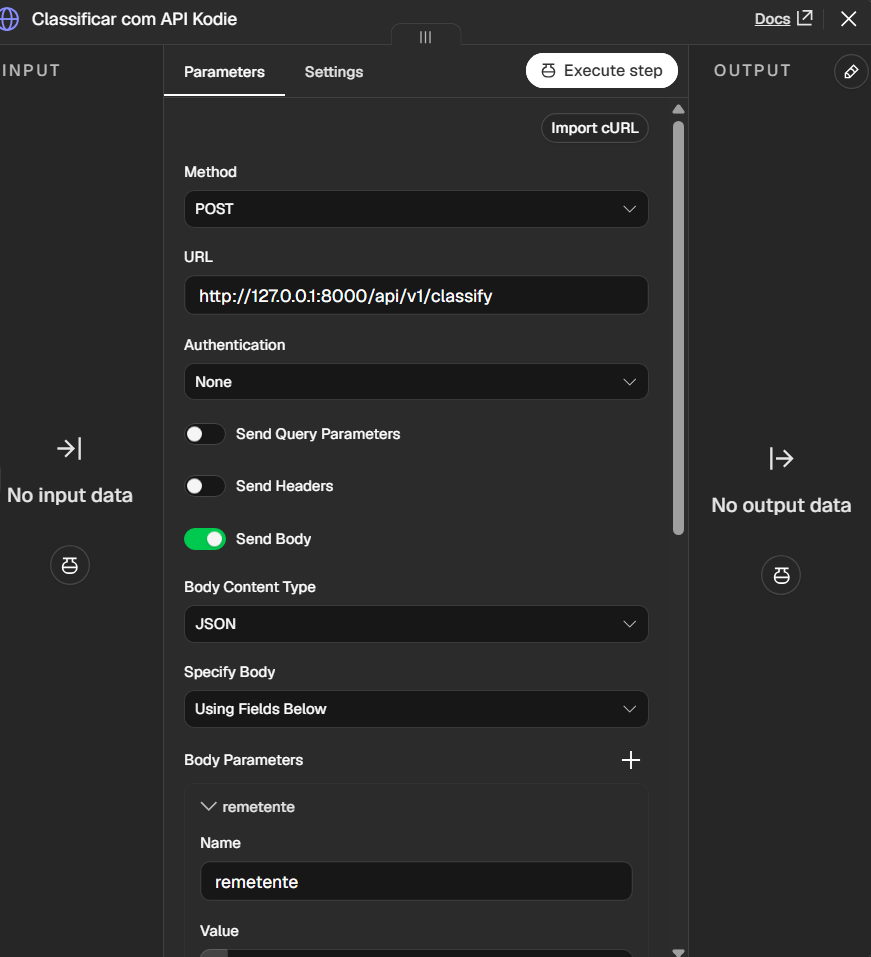
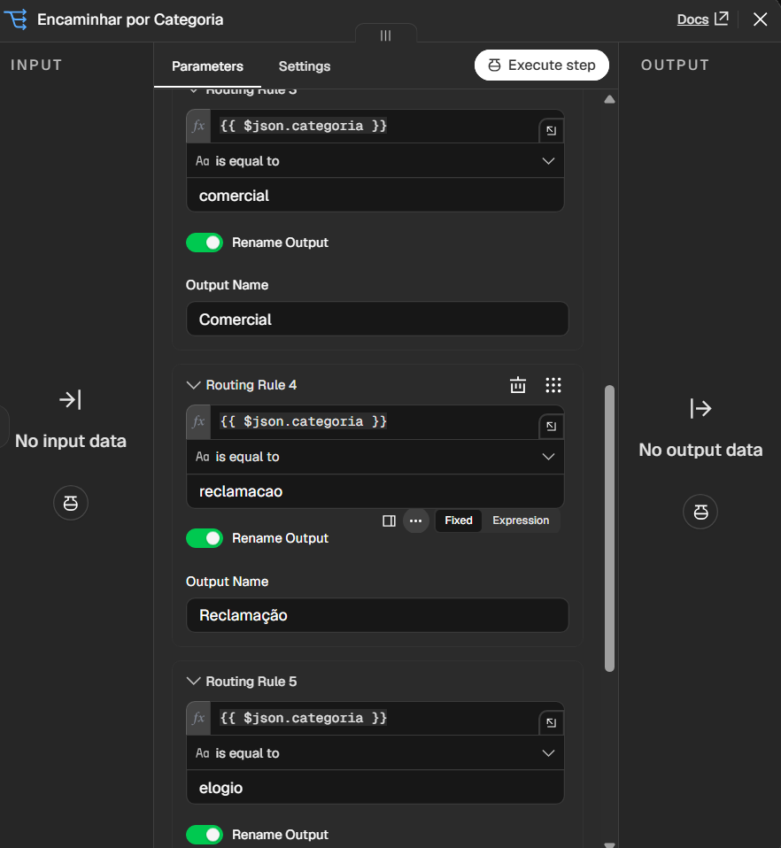
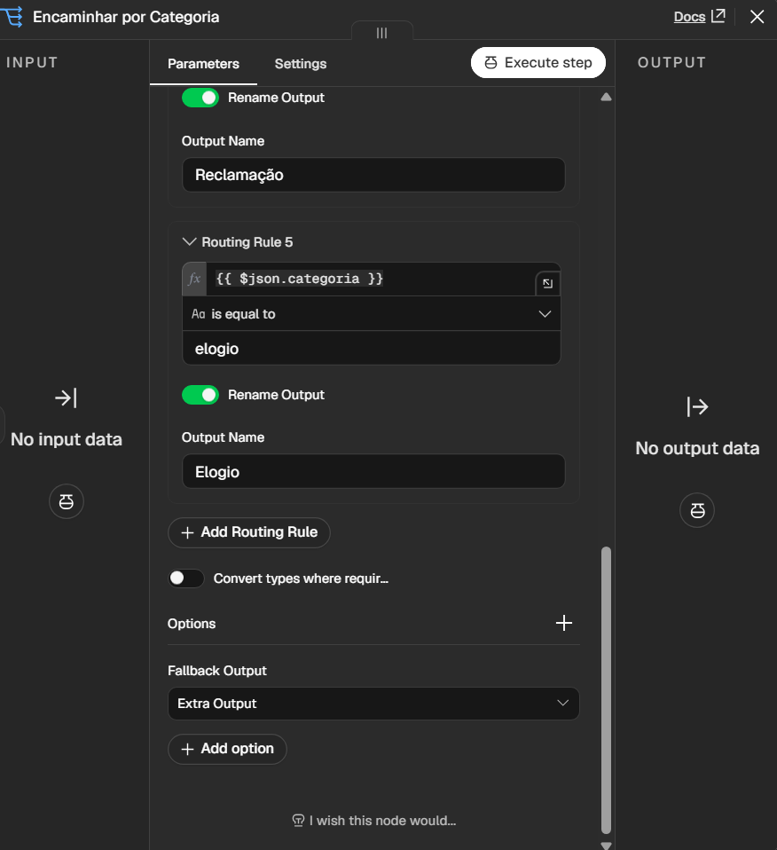
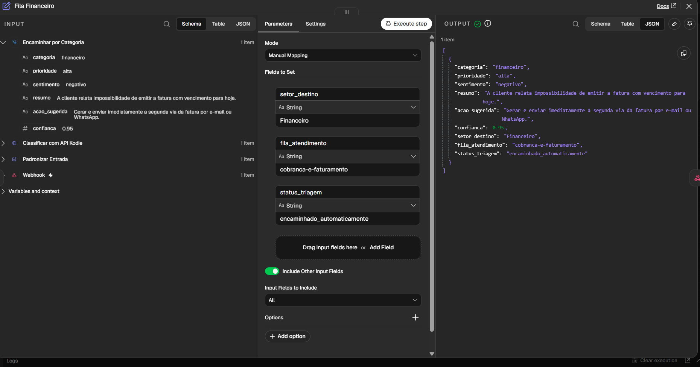

# Kodie — Classificador de Mensagens com IA e Automação n8n

Sistema de classificação inteligente e roteamento automático de mensagens em português, integrando uma API REST em **FastAPI + Google Gemini** a um fluxo de orquestração no **n8n**.

## Arquitetura do Fluxo

O workflow `Kodie - Classificador de Mensagens com IA` recebe mensagens via Webhook HTTP, normaliza os dados de entrada, consulta a API de classificação com IA, direciona cada atendimento para a fila correspondente e devolve um JSON consolidado com a análise da IA e os metadados de triagem.

```text
Webhook (POST)
  └──► Padronizar Entrada (Edit Fields)
         └──► Classificar com API Kodie (HTTP Request → FastAPI/Gemini)
                └──► Encaminhar por Categoria (Switch)
                       ├── Financeiro       ──► Fila Financeiro       ──┐
                       ├── Suporte Técnico  ──► Fila Suporte Técnico  ──┤
                       ├── Comercial        ──► Fila Comercial        ──┼──► Retornar Resposta
                       ├── Reclamação       ──► Fila Ouvidoria        ──┤    (Respond to Webhook)
                       ├── Elogio           ──► Fila Relacionamento   ──┤
                       └── Fallback         ──► Fila Atendimento Geral ─┘
```


## Estrutura do Projeto

```text
kodie_classificador_mensagens/
├── app/
│   ├── core/
│   ├── prompts/
│   ├── schemas/
│   ├── services/
│   └── main.py
├── automation/
├── docs/
│   └── images/                              # Evidências visuais do fluxo e testes
├── n8n/
│   └── workflow_classificador_mensagens.json # Workflow exportado pronto para importação
├── tests/
├── .env.example
├── .gitignore
├── README.md
└── requirements.txt
```

## Regras de Roteamento (Switch e Filas)

Todos os nodes de fila utilizam `Manual Mapping` com **`Include Other Input Fields = All`**, preservando integralmente os 6 campos retornados pela IA (`categoria`, `prioridade`, `sentimento`, `resumo`, `acao_sugerida` e `confianca`) e adicionando os 3 campos operacionais de roteamento (`setor_destino`, `fila_atendimento` e `status_triagem`).

| Categoria (`$json.categoria`) | Node de Destino | Setor (`setor_destino`) | Status (`status_triagem`) |
| :--- | :--- | :--- | :--- |
| `financeiro` | `Fila Financeiro` | Financeiro | `encaminhado_automaticamente` |
| `suporte_tecnico` | `Fila Suporte Técnico` | Suporte Técnico | `encaminhado_automaticamente` |
| `comercial` | `Fila Comercial` | Comercial | `encaminhado_automaticamente` |
| `reclamacao` | `Fila Ouvidoria` | Ouvidoria / Reclamações | `encaminhado_automaticamente` |
| `elogio` | `Fila Relacionamento` | Relacionamento (CS) | `encaminhado_automaticamente` |
| *(Fallback)* | `Fila Atendimento Geral` | Atendimento Geral | `encaminhado_automaticamente` |

> **Resiliência:** o node `Classificar com API Kodie` está configurado com **Retry On Fail**, absorvendo oscilações temporárias (como `502 Bad Gateway` / `503 UNAVAILABLE`) na comunicação com o modelo Gemini sem interromper o fluxo imediatamente.

## Como Executar e Importar o Workflow

### 1. Subir a API FastAPI localmente
1. Crie o arquivo `.env` a partir de `.env.example` e preencha sua chave da API do Gemini.
2. Ative o ambiente virtual e instale as dependências:
   ```powershell
   .\.venv\Scripts\Activate.ps1
   pip install -r requirements.txt
   ```
3. Inicie o servidor Uvicorn:
   ```powershell
   uvicorn app.main:app --reload
   ```
   A API ficará disponível em `[http://127.0.0.1:8000/api/v1/classify]`.

### 2. Importar o fluxo no n8n
1. Inicie sua instância do n8n (por padrão em `http://localhost:5678`).
2. Crie um novo workflow, clique no menu **`...`** no topo superior e selecione **`Import` → `From file`**.
3. Escolha o arquivo `n8n/workflow_classificador_mensagens.json`.
4. Salve o fluxo (`Ctrl + S`) e clique em **`Execute`** para colocar o Webhook de teste em escuta.

## Teste Ponta a Ponta (PowerShell)

Com a API FastAPI ativa e o n8n em modo de escuta, execute:

```powershell
$body = @{
    remetente = "maria.silva@exemplo.com"
    canal     = "whatsapp"
    mensagem  = "Não consigo emitir a segunda via da minha fatura e ela vence hoje!"
} | ConvertTo-Json

$bytes = [System.Text.Encoding]::UTF8.GetBytes($body)

Invoke-RestMethod -Uri "http://localhost:5678/webhook-test/classificar-mensagem" `
    -Method Post `
    -ContentType "application/json; charset=utf-8" `
    -Body $bytes | ConvertTo-Json -Depth 5
```

### Exemplo de Resposta Consolidada (9 campos)

```json
{
  "categoria": "financeiro",
  "prioridade": "alta",
  "sentimento": "negativo",
  "resumo": "A cliente relata impossibilidade de emitir a fatura com vencimento para hoje.",
  "acao_sugerida": "Gerar e enviar imediatamente a segunda via da fatura por e-mail ou WhatsApp.",
  "confianca": 0.95,
  "setor_destino": "Financeiro",
  "fila_atendimento": "cobranca-e-faturamento",
  "status_triagem": "encaminhado_automaticamente"
}
```

## Evidências da Configuração e Execução

### Configuração dos Nodes
<details>
<summary>Clique para expandir os prints de configuração interna dos nodes</summary>

#### 1. Padronização da Entrada


#### 2. Integração HTTP com a API FastAPI / Gemini



#### 3. Regras de Roteamento no Switch




#### 4. Mapeamento das Filas (Edit Fields)


</details>

### Validação em Execução
#### Fluxo Executado com Sucesso


#### Saída JSON Consolidada (IA + Roteamento)


#### Resposta no Terminal PowerShell e Repositório
