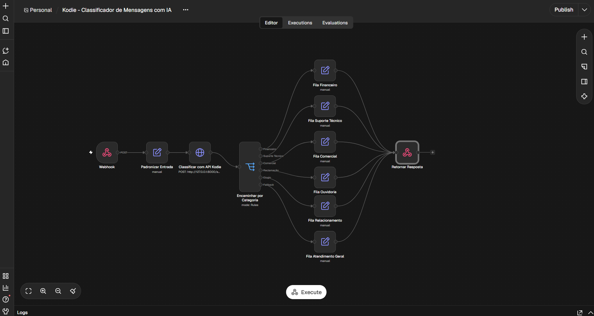
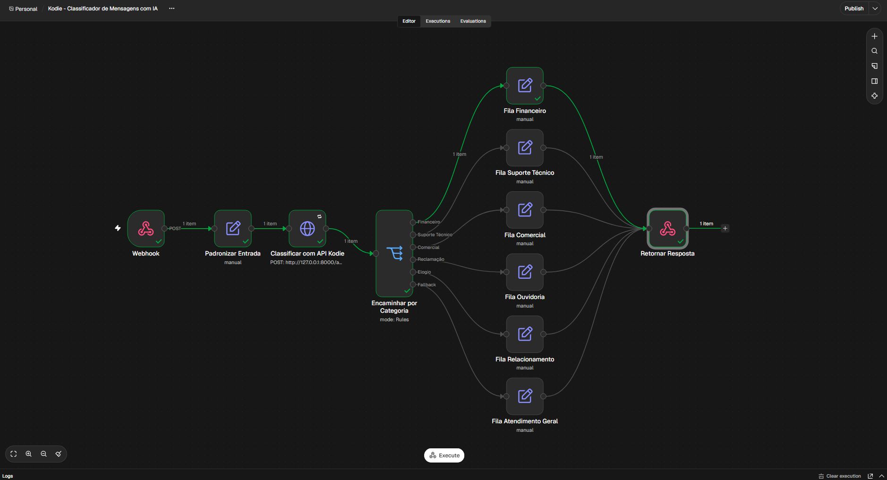
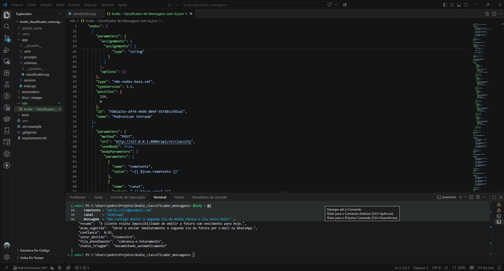

# Classificador de Mensagens com IA, Helpdesk Full-Stack e Automação n8n

Sistema full-stack de classificação inteligente, abertura de chamados e roteamento automático de mensagens em português, integrando uma API REST em **FastAPI + Google Gemini**, persistência em **SQLite** com autenticação **JWT**, interface web em **React + TypeScript**, orquestração no **n8n** e execução containerizada via **Docker Compose**.

## Funcionalidades

- **Triagem automática com IA (Google Gemini):** classifica `categoria`, `prioridade`, `sentimento`, `confianca`, `resumo` e `acao_sugerida` a partir da mensagem enviada.
- **Autenticação e controle de acesso:** cadastro e login de usuários com senha criptografada em `bcrypt` e sessões protegidas por token **JWT (Bearer)**.
- **Central de chamados com protocolo único:** abertura de tickets com protocolo no formato `CHM-YYYYMMDD-XXXX`, persistência em **SQLite (SQLAlchemy)**, busca por protocolo, filtros por status/categoria e atualização de status.
- **Interface web responsiva (React + TypeScript):** painel de métricas, formulário de abertura de chamado com análise da IA em tempo real e histórico interativo.
- **Roteamento automático por setor (API e n8n):** encaminhamento inteligente para filas dedicadas com preservação integral dos campos da IA e resiliência via *Retry On Fail*.
- **Containerização completa:** back-end em Python/FastAPI e front-end em React/Nginx orquestrados via `docker-compose.yml` com volume persistente (`helpdesk_data`).

## Stack Tecnológica

| Camada | Tecnologias |
| :--- | :--- |
| **Back-end** | Python 3.12, FastAPI, Uvicorn, Pydantic v2, SQLAlchemy, PyJWT, bcrypt |
| **Inteligência Artificial** | Google Gemini API (`google-genai`) |
| **Banco de Dados** | SQLite (`classificacao_mensagens.db`) |
| **Front-end** | React, TypeScript, Vite, Nginx |
| **Automação** | n8n |
| **Testes** | Pytest, FastAPI TestClient |
| **Infraestrutura** | Docker, Docker Compose |

## Arquitetura do Sistema e do Fluxo n8n

A API FastAPI atende simultaneamente o **Portal Web de Chamados (React)** — com autenticação JWT, geração de protocolos e persistência em SQLite — e o workflow **`Kodie - Classificador de Mensagens com IA` no n8n**, que recebe mensagens via Webhook HTTP, normaliza os dados de entrada, consulta a API de classificação, direciona cada atendimento para a fila correspondente e devolve um JSON consolidado.

```text
Portal Web (React/Nginx :8080) ──► API FastAPI (:8000) ──► Google Gemini + SQLite (JWT + Protocolos CHM-...)

Webhook n8n (POST)
  └──► Padronizar Entrada (Edit Fields)
         └──► Classificar com API Kodie (HTTP Request → FastAPI/Gemini)
                └──► Encaminhar por Categoria (Switch)
                       ├── Financeiro       ──► Fila Financeiro       ──┐
                       ├── Suporte Técnico  ──► Fila Suporte Técnico  ──┤
                       ├── Comercial        ──► Fila Comercial        ──┼──► Retornar Resposta
                       ├── Reclamação       ──► Fila Ouvidoria        ──┤    (Respond to Webhook)
                       ├── Elogio           ──► Fila Relacionamento   ──┤
                       └── Fallback         ──► Fila Atendimento Geral ─┘
```



## Estrutura do Projeto

```text
kodie_classificador_mensagens/
├── app/
│   ├── core/                                 # Configurações (.env), conexão SQLite e segurança JWT/bcrypt
│   ├── models/                               # Modelos ORM (User e Ticket)
│   ├── prompts/                              # Prompts estruturados para o Google Gemini
│   ├── routers/                              # Rotas de autenticação (/auth) e chamados (/tickets)
│   ├── schemas/                              # Contratos Pydantic de entrada e saída
│   ├── services/                             # Integração com a API do Google Gemini
│   └── main.py                               # Inicialização da API, CORS e endpoints base
├── automation/
├── docs/
│   └── images/                               # Evidências visuais do fluxo, configuração e testes
├── frontend/
│   ├── src/
│   │   ├── components/                       # AuthForm e TicketCard
│   │   ├── services/                         # Cliente HTTP tipado (api.ts)
│   │   ├── types/                            # Interfaces TypeScript
│   │   └── App.tsx                           # Painel principal e controle de estado
│   ├── Dockerfile                            # Multi-stage build (Node + Nginx)
│   └── nginx.conf                            # Configuração SPA do Nginx
├── n8n/
│   └── workflow_classificador_mensagens.json # Workflow exportado pronto para importação
├── tests/                                    # Testes automatizados (API, Auth e Chamados)
├── Dockerfile                                # Imagem da API FastAPI
├── docker-compose.yml                        # Orquestração Full-Stack + volume SQLite
├── pytest.ini                                # Configuração do PYTHONPATH para o Pytest
├── .dockerignore
├── .env.example
├── .gitignore
├── README.md
└── requirements.txt
```

## Principais Endpoints da API

| Método | Rota | Descrição | Auth |
| :--- | :--- | :--- | :--- |
| `GET` | `/health` | Verifica disponibilidade da API | Pública |
| `POST` | `/api/v1/classify` | Classifica uma mensagem avulsa via Gemini (utilizado também pelo n8n) | Pública |
| `POST` | `/api/v1/auth/register` | Cadastra um novo usuário | Pública |
| `POST` | `/api/v1/auth/login` | Autentica credenciais e retorna o token JWT | Pública |
| `GET` | `/api/v1/auth/me` | Retorna os dados do usuário autenticado | Bearer JWT |
| `POST` | `/api/v1/tickets` | Abre chamado, classifica via IA, roteia e gera protocolo `CHM-...` | Bearer JWT |
| `GET` | `/api/v1/tickets` | Lista chamados do usuário (filtros opcionais `status` e `categoria`) | Bearer JWT |
| `GET` | `/api/v1/tickets/{protocolo}` | Consulta detalhes de um chamado pelo protocolo | Bearer JWT |
| `PATCH` | `/api/v1/tickets/{protocolo}/status` | Atualiza o status (`aberto`, `em_andamento`, `resolvido`, `fechado`) | Bearer JWT |

## Regras de Roteamento (Switch e Filas)

Todos os nodes de fila no n8n utilizam `Manual Mapping` com **`Include Other Input Fields = All`**, preservando integralmente os 6 campos retornados pela IA (`categoria`, `prioridade`, `sentimento`, `resumo`, `acao_sugerida` e `confianca`) e adicionando os 3 campos operacionais de roteamento (`setor_destino`, `fila_atendimento` e `status_triagem`). As mesmas regras de setor e fila também são aplicadas na abertura de chamados pela API.

| Categoria (`$json.categoria`) | Node de Destino | Setor (`setor_destino`) | Status (`status_triagem`) |
| :--- | :--- | :--- | :--- |
| `financeiro` | `Fila Financeiro` | Financeiro | `encaminhado_automaticamente` |
| `suporte_tecnico` | `Fila Suporte Técnico` | Suporte Técnico | `encaminhado_automaticamente` |
| `comercial` | `Fila Comercial` | Comercial | `encaminhado_automaticamente` |
| `reclamacao` | `Fila Ouvidoria` | Ouvidoria / Reclamações | `encaminhado_automaticamente` |
| `elogio` | `Fila Relacionamento` | Relacionamento (CS) | `encaminhado_automaticamente` |
| *(Fallback)* | `Fila Atendimento Geral` | Atendimento Geral | `encaminhado_automaticamente` |

> **Resiliência:** o node `Classificar com API Kodie` está configurado com **Retry On Fail**, absorvendo oscilações temporárias (como `502 Bad Gateway` / `503 UNAVAILABLE`) na comunicação com o modelo Gemini sem interromper o fluxo imediatamente.

## Como Executar com Docker (Recomendado)

### Pré-requisitos
- Docker e Docker Compose instalados
- Chave de API do [Google AI Studio (Gemini)](https://aistudio.google.com/)

### Passo a passo
1. Clone o repositório e acesse a pasta do projeto:
   ```powershell
   git clone [https://github.com/Pedrojorge11/kodie_classificador_mensagens.git](https://github.com/Pedrojorge11/kodie_classificador_mensagens.git)
   cd kodie_classificador_mensagens
   ```
2. Crie o arquivo `.env` a partir de `.env.example` e preencha sua chave da API do Gemini e uma chave secreta para o JWT:
   ```env
   GEMINI_API_KEY=sua_chave_aqui
   GEMINI_MODEL=gemini-3.5-flash-lite
   DATABASE_URL=sqlite:///./classificacao_mensagens.db
   JWT_SECRET_KEY=sua_chave_secreta_aqui
   JWT_ALGORITHM=HS256
   JWT_EXPIRE_MINUTES=120
   ```
3. Suba o back-end e o front-end com um único comando:
   ```powershell
   docker compose up --build
   ```
4. Acesse a aplicação:
   - **Portal Web (React + Nginx):** `http://localhost:8080`
   - **Documentação Swagger (FastAPI):** `http://localhost:8000/docs`
   - **Endpoint de classificação (n8n):** `http://localhost:8000/api/v1/classify`

> Os dados do SQLite ficam armazenados no volume Docker `helpdesk_data`, preservando usuários e chamados entre reinicializações. Para encerrar os containers, execute `docker compose down`.

## Como Executar Localmente e Importar o Workflow n8n

### 1. Subir a API FastAPI localmente
1. Crie o arquivo `.env` a partir de `.env.example` e preencha suas variáveis de ambiente.
2. Ative o ambiente virtual e instale as dependências:
   ```powershell
   .\.venv\Scripts\Activate.ps1
   pip install -r requirements.txt
   ```
3. Inicie o servidor Uvicorn:
   ```powershell
   uvicorn app.main:app --reload
   ```
   A API ficará disponível em `http://127.0.0.1:8000` (Swagger em `/docs` e classificação em `/api/v1/classify`).

### 2. Subir o Front-end (React + Vite)
Em um segundo terminal:
```powershell
cd frontend
npm install
npm run dev
```
A interface ficará disponível em `http://localhost:5173`.

### 3. Importar o fluxo no n8n
1. Inicie sua instância do n8n (por padrão em `http://localhost:5678`).
2. Crie um novo workflow, clique no menu **`...`** no topo superior e selecione **`Import` → `From file`**.
3. Escolha o arquivo `n8n/workflow_classificador_mensagens.json`.
4. Salve o fluxo (`Ctrl + S`) e clique em **`Execute`** para colocar o Webhook de teste em escuta.

## Testes

### Testes Automatizados (Pytest)
A suíte valida os endpoints de saúde, classificação, autenticação JWT e ciclo completo de chamados usando SQLite em memória e mock do Gemini (sem consumir cota da API):

```powershell
python -m pytest -v
```

### Teste Ponta a Ponta com n8n (PowerShell)
Com a API FastAPI ativa e o n8n em modo de escuta, execute:

```powershell
$body = @{
    remetente = "maria.silva@exemplo.com"
    canal     = "whatsapp"
    mensagem  = "Não consigo emitir a segunda via da minha fatura e ela vence hoje!"
} | ConvertTo-Json

$bytes = [System.Text.Encoding]::UTF8.GetBytes($body)

Invoke-RestMethod -Uri "http://localhost:5678/webhook-test/classificar-mensagem" `
    -Method Post `
    -ContentType "application/json; charset=utf-8" `
    -Body $bytes | ConvertTo-Json -Depth 5
```

### Exemplo de Resposta Consolidada (9 campos)

```json
{
  "categoria": "financeiro",
  "prioridade": "alta",
  "sentimento": "negativo",
  "resumo": "A cliente relata impossibilidade de emitir a fatura com vencimento para hoje.",
  "acao_sugerida": "Gerar e enviar imediatamente a segunda via da fatura por e-mail ou WhatsApp.",
  "confianca": 0.95,
  "setor_destino": "Financeiro",
  "fila_atendimento": "cobranca-e-faturamento",
  "status_triagem": "encaminhado_automaticamente"
}
```

## Evidências da Configuração e Execução

### Configuração dos Nodes (n8n)
<details>
<summary>Clique para expandir os prints de configuração interna dos nodes</summary>

#### 1. Padronização da Entrada


#### 2. Integração HTTP com a API FastAPI / Gemini


#### 3. Regras de Roteamento no Switch


#### 4. Mapeamento das Filas (Edit Fields)


</details>

### Validação em Execução
#### Fluxo Executado com Sucesso


#### Saída JSON Consolidada (IA + Roteamento)


#### Resposta no Terminal PowerShell e Repositório


## Autor

Desenvolvido por **Pedro Jorge da Silva** — [GitHub (@Pedrojorge11)](https://github.com/Pedrojorge11)